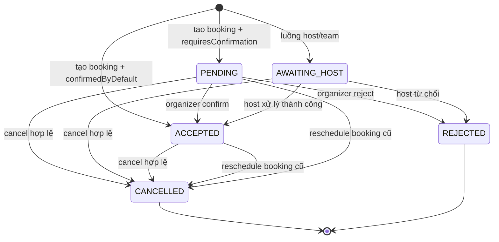

# Issue 05 - Mô hình trạng thái booking cho Model-Based Testing

Tài liệu này mô tả mô hình trạng thái dùng để thiết kế kiểm thử dựa trên mô hình (MBT) cho booking. Mô hình được đối chiếu với mã nguồn trên nhánh `qa/model-based-booking` và với bằng chứng chạy thử đã có trong [Issue 04](issue-04-booking-business-data.md). Các kết luận được gắn nhãn **[Code]**, **[Test]**, **[Observed]** hoặc **[Assumption]** để không nhầm suy luận với quan sát thực tế.

Nguyên lý MBT, phạm vi, rủi ro và tiêu chí pass/fail của model v2 được tổng hợp tại [Phần D - Issue 17](issue-17-mbt-principles.md).

## 1. Phạm vi và quy ước

Phạm vi là một booking cá nhân không recurring, không seat, không thanh toán và không tích hợp calendar ngoài. Booker, host và event type dùng dữ liệu giả; thời gian được lưu/đối chiếu bằng UTC và hiển thị thêm `Asia/Saigon`. Mô hình không đại diện cho từng bản ghi database trung gian trong transaction và không suy ra trạng thái từ nhãn UI.

Các trạng thái lấy từ `BookingStatus` trong [`packages/prisma/schema.prisma`](../../packages/prisma/schema.prisma):

| Ký hiệu | `BookingStatus` | Ý nghĩa trong mô hình |
| --- | --- | --- |
| `PENDING` | `PENDING` | Booking cần organizer xác nhận. **[Code]** |
| `ACCEPTED` | `ACCEPTED` | Booking đã được xác nhận hoặc event type xác nhận mặc định. **[Code]** |
| `AWAITING_HOST` | `AWAITING_HOST` | Booking đang chờ host xử lý trong các luồng host/team. Có enum và logic liên quan, nhưng chưa chạy trong phạm vi này. **[Code][Assumption]** |
| `REJECTED` | `REJECTED` | Organizer từ chối booking chờ xác nhận. **[Test]** |
| `CANCELLED` | `CANCELLED` | Booking bị hủy, hoặc bản ghi cũ bị đóng khi đổi lịch. **[Test][Observed]** |

`CANCELLED` và `REJECTED` là trạng thái kết thúc của booking cụ thể trong phạm vi này. Một booking đã đổi lịch không bị xóa: booking cũ chuyển sang `CANCELLED`, còn booking mới có UID riêng và liên kết `fromReschedule` trỏ về UID cũ. **[Code][Observed]**

## 2. Sơ đồ trạng thái

Mũi tên tạo booking và các chuyển tiếp confirm/reject được xác định từ `createBooking.ts`, `confirm.handler.ts` và bài test `booking-confirm-reject.e2e.ts`. `AWAITING_HOST` chỉ là trạng thái được ghi nhận trong enum, không nằm trong model chạy của issue này. Việc hủy `PENDING` được thêm thành nhánh cần kiểm chứng qua ứng dụng; hủy `AWAITING_HOST` ngoài phạm vi. **[Code][Assumption]**

## 3. Bảng chuyển tiếp và oracle

| ID | Trạng thái trước | Sự kiện và điều kiện | Trạng thái sau | Oracle quan sát được | Nguồn |
| --- | --- | --- | --- | --- | --- |
| T01 | không có booking | Gửi form với event type xác nhận mặc định | `ACCEPTED` | Có đúng một booking; `status=ACCEPTED`; thời gian UTC khớp slot | [Issue 04 E2E](../../apps/web/playwright/issue-04-booking-lifecycle.e2e.ts), [evidence](evidence/issue-04-booking-lifecycle.json) **[Test][Observed]** |
| T02 | không có booking | Event type yêu cầu xác nhận; bài test tạo booking trực tiếp bằng Prisma với `status=PENDING` và token | `PENDING` | Booking có `status=PENDING`, còn token xác nhận | [`booking-confirm-reject.e2e.ts`](../../apps/web/playwright/booking-confirm-reject.e2e.ts) chỉ là **[Code]** cho trạng thái ban đầu; test không đi qua form đặt lịch |
| T03 | `PENDING` | Organizer confirm bằng token hợp lệ | `ACCEPTED` | HTTP redirect thành công; `status=ACCEPTED`; `oneTimePassword=null` | [booking-confirm-reject.e2e.ts](../../apps/web/playwright/booking-confirm-reject.e2e.ts) **[Test]** |
| T04 | `PENDING` | Organizer reject bằng token hợp lệ và lý do | `REJECTED` | HTTP redirect thành công; `status=REJECTED`; `rejectionReason` khớp; token bị xóa | [booking-confirm-reject.e2e.ts](../../apps/web/playwright/booking-confirm-reject.e2e.ts) **[Test]** |
| T05 | `ACCEPTED` hoặc `PENDING` | Reschedule hợp lệ tới slot mới | Bản ghi cũ `CANCELLED`; bản ghi mới `ACCEPTED` hoặc `PENDING` tùy cấu hình | UID mới khác UID cũ; cũ có `rescheduled=true`; mới có `fromReschedule=UID cũ`; thời gian mới khác | [`createBooking.ts`](../../packages/features/bookings/lib/handleNewBooking/createBooking.ts), [Issue 04 E2E](../../apps/web/playwright/issue-04-booking-lifecycle.e2e.ts) **[Code][Observed]** |
| T06 | `ACCEPTED` | Cancel hợp lệ trước khi booking kết thúc | `CANCELLED` | `status=CANCELLED`; `cancellationReason` khớp **[Test][Observed]**. `cancelledBy` được ghi và UID không đổi **[Code]** | [Issue 04 E2E](../../apps/web/playwright/issue-04-booking-lifecycle.e2e.ts), [`handleCancelBooking.ts`](../../packages/features/bookings/lib/handleCancelBooking.ts) |
| T07 | `CANCELLED` với `rescheduled=false` | Dùng lại link reschedule | Không tạo booking mới | Request bị từ chối với lỗi booking đã hủy không thể đổi lịch | [`originalRescheduledBookingUtils.ts`](../../packages/features/bookings/lib/handleNewBooking/originalRescheduledBookingUtils.ts) **[Code]** |
| T08 | bất kỳ trạng thái | Slot mới không khả dụng, thiếu quyền, quá hạn hoặc vi phạm minimum notice | Không đổi trạng thái thành công | Request lỗi; phải kiểm tra status và không chấp nhận oracle “đã đổi lịch” | [`RegularBookingService.ts`](../../packages/features/bookings/lib/service/RegularBookingService.ts), [`determineReschedulePreventionRedirect.ts`](../../packages/features/bookings/lib/reschedule/determineReschedulePreventionRedirect.ts) **[Code]** |

Trong T05, `fromReschedule` là liên kết logic giữa hai booking, không phải UID được tái sử dụng. Bằng chứng Issue 01 cho thấy UID A và UID B khác nhau, B lưu `fromReschedule=UID A`; tài liệu Issue 01 cũng ghi rõ trạng thái database ngay sau từng bước của phiên cũ chưa được chụp riêng. Vì vậy chỉ dùng bằng chứng Issue 04 để đánh dấu chuyển tiếp T05 là đã quan sát. **[Observed]**

### Ánh xạ sang model GraphWalker

[`docs/qa/model/booking-model-v2.json`](model/booking-model-v2.json) mô hình hóa phạm vi mở rộng của Issue #17. Harness Issue #6 hiện tại dùng [`docs/qa/model/booking-model-v1.json`](model/booking-model-v1.json), vì vậy không được đổi tên edge/vertex của v1 cho đến khi harness tương thích được cập nhật:

| Vertex GraphWalker | Trạng thái dữ liệu tương ứng |
| --- | --- |
| `v_NoBooking` | Chưa có booking trong phiên kiểm thử; điểm bắt đầu của model. |
| `v_Pending` | Booking vừa được tạo cho event type yêu cầu organizer xác nhận; `status=PENDING`. |
| `v_BookedA` | Booking A đã được xác nhận hoặc event type xác nhận mặc định; `status=ACCEPTED`. Đây là booking trước reschedule. |
| `v_BookedB` | Booking B mới sau reschedule; `status=ACCEPTED`, UID khác A và `fromReschedule=UID A`. |
| `v_Rejected` | Booking bị organizer từ chối; `status=REJECTED`. |
| `v_Cancelled` | Booking bị hủy từ `PENDING` hoặc `ACCEPTED`; `status=CANCELLED`. |
| `v_SlotUnavailable` | Nhánh lỗi khi đổi lịch không tạo B vì slot mới không còn khả dụng; booking A vẫn là bản ghi hiện hành. |

Các edge `e_CreateAcceptedBooking`, `e_CreatePendingBooking`, `e_ConfirmPendingBooking`, `e_RejectPendingBooking` và `e_CancelPendingBooking` bổ sung các chuỗi tạo booking cần xác nhận, confirm, reject và hủy khi `PENDING`. Các edge hủy `ACCEPTED`, reschedule và xử lý slot không khả dụng giữ lại các nhánh Issue 04. `AWAITING_HOST` được giữ trong bảng trạng thái nghiệp vụ nhưng không có vertex/edge trong model vì issue này không triển khai hoặc kiểm chứng luồng host/team.

## 4. Tiêu chí coverage

Một phiên MBT đạt khi thỏa cả bốn nhóm sau:

1. **State coverage:** phải xuất hiện `PENDING`, `ACCEPTED`, `REJECTED` và `CANCELLED` (4/5 trạng thái nghiệp vụ); `AWAITING_HOST` được ghi rõ ngoài phạm vi.
2. **Transition coverage:** model phải đạt `edge_coverage(100)` cho toàn bộ 12 edge, bao gồm ba nhánh `PENDING -> ACCEPTED/REJECTED/CANCELLED`.
3. **Vertex coverage:** đạt `vertex_coverage(100)` để mọi vertex trong model đều được đi qua; `v_SlotUnavailable` là vertex lỗi kỹ thuật, không được tính là trạng thái BookingStatus.
4. **Guard coverage:** có một ca event type xác nhận mặc định, một ca yêu cầu xác nhận, một ca token hợp lệ và một ca slot/điều kiện reschedule không hợp lệ.
5. **Data-oracle coverage:** sau mỗi bước đọc chỉ các trường `uid`, `status`, `rescheduled`, `fromReschedule`, `startTime`, `endTime`, `cancellationReason`, `rejectionReason`, `oneTimePassword` và các cờ actor cần thiết; không ghi email, token, credential hoặc URL quản lý.

## 5. Ba chuỗi kiểm thử tối thiểu

Các chuỗi dưới đây là kế hoạch kiểm thử và oracle. Chuỗi S01 đã có kết quả chạy trong Issue 04; S02-S04 phải chạy qua form/ứng dụng và đọc oracle DB sau từng bước. Fixture Prisma trong test cũ chỉ được dùng để tham khảo token confirm/reject, không được coi là bằng chứng thay thế cho application flow.

| Chuỗi | Các bước | Nhánh được phủ | Oracle cuối chuỗi |
| --- | --- | --- | --- |
| S01 - happy path và reschedule | T01 tạo A `ACCEPTED` → T05 đổi A sang B → T06 hủy B | tạo mặc định, UID mới, liên kết cũ-mới, hủy | A: `CANCELLED` + `rescheduled=true`; B: UID khác, `fromReschedule=A.uid`; sau hủy B: `CANCELLED` + lý do đúng; không có booking mới ngoài A/B |
| S02 - confirm | Tạo booking từ form với event type yêu cầu xác nhận → organizer confirm | `NoBooking → PENDING → ACCEPTED` | Booking giữ nguyên UID; trạng thái cuối `ACCEPTED`; token xác nhận bị xóa |
| S03 - reject | Tạo booking từ form với event type yêu cầu xác nhận → organizer reject với lý do | `NoBooking → PENDING → REJECTED` | Booking giữ nguyên UID; trạng thái cuối `REJECTED`; lý do khớp; token bị xóa |
| S04 - cancel pending | Tạo booking từ form với event type yêu cầu xác nhận → hủy trước khi confirm | `NoBooking → PENDING → CANCELLED` | Booking giữ nguyên UID; trạng thái cuối `CANCELLED`; lý do hủy khớp |

### Điều kiện pass/fail

- **Pass:** trạng thái và các trường liên kết sau mỗi bước khớp bảng T01-T08; mã HTTP/UI chỉ là tín hiệu phụ, không thay thế truy vấn dữ liệu.
- **Fail:** một trạng thái không thuộc chuyển tiếp, UID mới trùng UID cũ, `fromReschedule` trỏ sai, booking cũ không bị đánh dấu `rescheduled`, hoặc lý do/token không khớp oracle.
- **Chưa kiểm chứng:** không được ghi là pass khi chỉ nhìn UI, khi chỉ đọc trạng thái cuối sau nhiều bước, hoặc khi test dừng trước truy vấn sau bước đó.

## 6. Giới hạn và việc cần chạy thêm

- `AWAITING_HOST`, team/round-robin, seats, recurring, payment, calendar ngoài, email và webhook delivery nằm ngoài phạm vi issue này; không được tính vào state coverage.
- Chưa kiểm chứng retry/resubmit token và các chuyển tiếp sau khi booking đã bắt đầu.
- `REJECTED` được xác nhận bằng bài test token; chưa có bằng chứng UI độc lập cho mọi đường confirm/reject.
- Model GraphWalker dùng định dạng JSON của GraphWalker 4.3.3, đặt `v_NoBooking` làm start element và generator mặc định `random(edge_coverage(100))`. `vertex_coverage(100)` là mức tối thiểu để kiểm tra mọi vertex; state coverage nghiệp vụ tối thiểu là 4/5 vì `AWAITING_HOST` nằm ngoài phạm vi.
- Lệnh kiểm tra v2 với CLI 4.3.3 cần truyền model và generator thành cùng một tham số `-m`: `java -jar tools/graphwalker/graphwalker-cli-4.3.3.jar check -m docs/qa/model/booking-model-v2.json "random(edge_coverage(100))"` và `java -jar tools/graphwalker/graphwalker-cli-4.3.3.jar offline -m docs/qa/model/booking-model-v2.json "random(edge_coverage(100))"`. CLI 4.3.3 không chấp nhận `check -m <file>` đơn lẻ vì option `-m` yêu cầu thêm generator/stop condition.
- Issue 01 chứng minh quan hệ UID qua ảnh đã che và truy vấn sau chuỗi, nhưng không được dùng để suy ra trạng thái database trung gian. Issue 04 là nguồn quan sát cho T01/T05/T06 vì nó đọc DB ngay sau từng bước.
- Khi mở rộng mô hình, thêm fixture cho từng trạng thái/guard còn thiếu và giữ truy vấn oracle ở dạng `select` tối thiểu, không xuất dữ liệu nhạy cảm.

