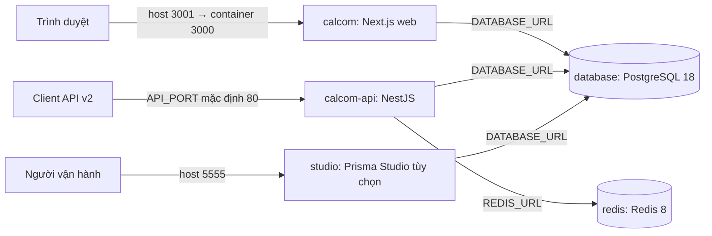
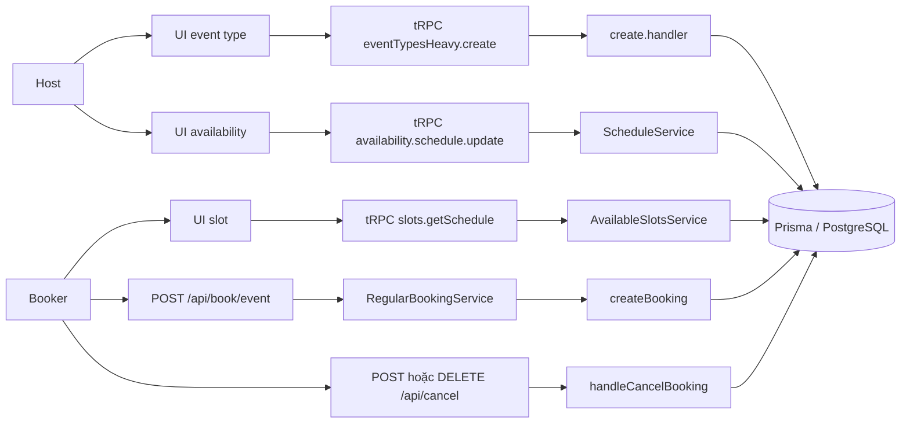

# Phần A–B — Mục tiêu hệ thống và kiến trúc kiểm thử booking

Tài liệu hợp nhất Phần A từ [Issue 01](issue-01-booking-onboarding-architecture.md) và Phần B từ [Issue 02](booking-flow-nghia.md) cho [Task #15](https://github.com/BoyTay/cal.diy/issues/15). Hai tài liệu gốc giữ lại chi tiết cài đặt, điều kiện lỗi và các lần chạy trước; các sơ đồ và bảng dưới đây là bản tổng hợp dùng chung khi thiết kế kiểm thử theo mô hình (MBT).

| Mốc | Giá trị và cách sử dụng |
| --- | --- |
| Nhánh tích hợp | `qa/model-based-booking` |
| SHA mã nguồn đã đối chiếu | `e469624ecba0520f45df8d3830ecd231f4b99c48` |
| Baseline MBT | Tag `mbt-baseline-1`, commit `280ae3a6d3a58961f4552025f470ae52c829a96c` |
| Bằng chứng chạy baseline | [Lần chạy từ checkout riêng ngày 02/11/2026](evidence/issue-06-2026-11-02T15-07-24-820Z.json): `pass`, edge 6/6, vertex 5/5; evidence ghi `dirty=true` do khác ký tự xuống dòng sau cài đặt. Đây là kết quả trên commit của tag, không phải một lần chạy mới ở SHA khảo sát. |

## 1. Mục tiêu và phạm vi

Cal.diy cho phép **host** công bố event type và giờ khả dụng để **booker** chọn slot, đặt lịch, đổi sang slot khác hoặc hủy lịch. Trong phạm vi này, hệ thống phải phản ánh kết quả vào các bản ghi `Booking`, `EventType`, `Schedule` và `Availability`; trường `Booking.status` và liên kết đổi lịch là oracle cho MBT. Mục tiêu kiểm thử là xác nhận cả luồng thành công lẫn trường hợp slot mới không còn khả dụng mà booking cũ vẫn được giữ nguyên.

Phạm vi baseline là event type cá nhân, một booking không lặp lại, không có chỗ ngồi hay thanh toán. Các nhánh team, recurring, calendar ngoài và trạng thái cần host xác nhận chưa được bao phủ bởi baseline; xem [mô hình trạng thái](issue-05-booking-state-model.md) để biết các chuyển tiếp dự kiến ngoài phạm vi này.

| Actor | Use case trong phạm vi | Quan sát phục vụ kiểm thử |
| --- | --- | --- |
| Host/organizer | Tạo event type, chỉnh availability; có thể quản lý booking của mình | Cấu hình event type, schedule và slot công khai |
| Booker | Xem slot, đặt A, đổi A sang B, hủy B | Kết quả UI/API và trạng thái booking sau mỗi thao tác |
| Người chạy kiểm thử | Tạo dữ liệu giả, thực thi đường đi MBT, đọc oracle chỉ đọc | `status`, `rescheduled`, `fromReschedule`, thời gian và lý do hủy; không xuất định danh booking |
| Client API v2 | Gọi các endpoint API v2 khi kiểm thử lớp API riêng | Là bề mặt sản phẩm khác; baseline MBT ở trên đi qua web |

## 2. Cây thư mục liên quan

```text
apps/
  web/
    modules/event-types/, modules/availability/, modules/schedules/  # UI cấu hình và slot
    pages/api/book/event.ts                  # API web tạo/đổi booking
    app/api/cancel/route.ts                  # API web hủy booking
    playwright/mbt/issue-06.e2e.ts          # thực thi đường đi MBT và oracle
  api/v2/                                   # API v2, container riêng
packages/
  trpc/server/routers/viewer/               # handler event type, schedule, slot
  features/bookings/                        # nghiệp vụ tạo, đổi, hủy booking
  features/schedules/                       # cập nhật schedule
  prisma/schema.prisma                      # model và enum trạng thái
docs/qa/model/booking-model.json            # đồ thị trạng thái MBT
docs/qa/evidence/                            # kết quả đã lọc dữ liệu nhạy cảm
scripts/run-issue-06-mbt.mjs                # runner GraphWalker/Playwright
docker-compose.yml                          # các container triển khai cục bộ
```

Các đường dẫn trên là phần cần đọc cho bài kiểm thử, không phải toàn bộ monorepo. Điểm vào API v2 nằm trong `apps/api/v2`; luồng web baseline sử dụng các route ở `apps/web`.

## 3. Dependency chính

| Lớp | Dependency đã khai báo/cấu hình | Vai trò trong luồng này |
| --- | --- | --- |
| Monorepo và web | Yarn 4.12.0, Turbo 2.7.1; Next.js 16.2.3, React 18.2.0 ([manifest gốc](../../package.json), [web](../../apps/web/package.json)) | Build và phục vụ UI, route web |
| RPC và lưu trữ | tRPC 11.0.0-next-beta.222 ([manifest](../../packages/trpc/package.json)); Prisma Client 6.16.1 ([manifest](../../packages/prisma/package.json)) | UI gọi handler; service đọc/ghi PostgreSQL |
| Container | PostgreSQL 18 và Redis 8 ghim digest trong [Compose](../../docker-compose.yml); API v2 dùng NestJS 10.4.20 ([manifest](../../apps/api/v2/package.json)) | Database cho web/API v2; Redis là dependency của API v2 trong Compose |
| MBT | Playwright 1.57.0, Vitest 4.1.8 ([manifest gốc](../../package.json)); GraphWalker 4.3.3 với JDK 21 ([hướng dẫn harness](../../apps/web/playwright/mbt/README.md)) | Sinh đường đi, chạy thao tác và đối chiếu oracle; GraphWalker không nằm trong dependency Yarn |

Harness Issue #6 chạy web cục bộ với PostgreSQL 17 riêng, theo [README của harness](../../apps/web/playwright/mbt/README.md). Phiên đó không dùng PostgreSQL 18 trong Compose, vì vậy cần ghi rõ cách triển khai khi diễn giải evidence.

## 4. Sơ đồ container

Sơ đồ dưới đây mô tả [cấu hình Compose](../../docker-compose.yml), không khẳng định API v2 hoặc Studio tham gia request web của baseline MBT.



Compose công bố PostgreSQL ở `127.0.0.1:5433`; Redis ở cổng cấu hình `REDIS_PORT` (mặc định 6379). Hai image dữ liệu được ghim digest trong Compose. `calcom` và `calcom-api` được build từ mã nguồn nên phải gắn với SHA khi thu evidence.

## 5. Sơ đồ component của luồng web

Các cạnh sau được đối chiếu từ route, handler và lời gọi service tại SHA nêu trên. `rescheduleUid` đi qua cùng route tạo booking; hủy dùng route riêng.



Sơ đồ thể hiện đường gọi chính; các service còn có guard, cache và tích hợp phụ được mô tả chi tiết trong hai tài liệu nguồn. Đặc biệt, slot hiển thị không tự bảo đảm request đặt/đổi sau đó còn hợp lệ; service kiểm tra lại khả dụng khi tạo booking.

## 6. Năm module gắn trực tiếp với kiểm thử

| Module và điểm vào mã nguồn | Trách nhiệm có thể kiểm tra | Liên hệ với MBT |
| --- | --- | --- |
| **Event type** — [hook](../../apps/web/modules/event-types/hooks/useCreateEventType.ts) → [handler](../../packages/trpc/server/routers/viewer/eventTypes/heavy/create.handler.ts) | Tạo event type và cấu hình cần thiết cho lịch cá nhân | Tiền điều kiện của `e_CreateBookingA`; fixture baseline cũng có thể tạo event type trực tiếp |
| **Schedule/availability** — [UI](../../apps/web/modules/availability/availability-view.tsx) → [handler](../../packages/trpc/server/routers/viewer/availability/schedule/update.handler.ts) → [ScheduleService](../../packages/features/schedules/services/ScheduleService.ts) | Lưu giờ host cho phép đặt | Tiền điều kiện để xuất hiện slot A/B; thay đổi schedule cần kiểm thử riêng nếu muốn khẳng định slot đổi theo |
| **Slot** — [hook](../../apps/web/modules/schedules/hooks/useSchedule.ts) → [handler](../../packages/trpc/server/routers/viewer/slots/getSchedule.handler.ts) → [AvailableSlotsService DI](../../packages/features/di/containers/AvailableSlots.ts) | Tính slot ứng viên từ lịch và booking hiện có | `e_SelectAnotherSlot`, `e_RescheduleSlotUnavailable`; oracle cuối vẫn là phản hồi tạo booking và DB |
| **Tạo/đổi booking** — [route](../../apps/web/pages/api/book/event.ts) → [RegularBookingService](../../packages/features/bookings/lib/service/RegularBookingService.ts) → [createBooking](../../packages/features/bookings/lib/handleNewBooking/createBooking.ts) | Kiểm tra giới hạn/khả dụng, tạo A; với `rescheduleUid` hủy A và tạo B có `fromReschedule` | `e_CreateBookingA`, `e_RescheduleToB`, nhánh từ chối slot hết chỗ |
| **Hủy booking** — [route](../../apps/web/app/api/cancel/route.ts) → [handleCancelBooking](../../packages/features/bookings/lib/handleCancelBooking.ts) | Kiểm tra request, CSRF, quyền/điều kiện hủy rồi cập nhật trạng thái và lý do | `e_CancelBookingB`; oracle là B `CANCELLED` với lý do hủy tương ứng |

## 7. Luồng, nhánh lỗi và oracle

| Bước | Kết quả mong đợi cho cấu hình baseline | Nguồn xác nhận |
| --- | --- | --- |
| Đặt A khi slot trống | Tạo một booking A; baseline event type mặc định cho `status=ACCEPTED` | [Issue 02](booking-flow-nghia.md) giải thích trạng thái ban đầu phụ thuộc cấu hình; [bằng chứng MBT](evidence/issue-06-2026-11-02T15-07-24-820Z.json) xác nhận cấu hình baseline |
| Đổi A sang B hợp lệ | A thành `CANCELLED`, `rescheduled=true`; B có `fromReschedule` trỏ về A | [Issue 02](booking-flow-nghia.md) đối chiếu code; [bằng chứng MBT](evidence/issue-06-2026-11-02T15-07-24-820Z.json) chạy oracle sau thao tác |
| Hủy B hợp lệ | B thành `CANCELLED`, lưu lý do hủy | [Issue 02](booking-flow-nghia.md) và [bằng chứng MBT](evidence/issue-06-2026-11-02T15-07-24-820Z.json) |
| Đổi sang slot đã bị chiếm | Request baseline trả HTTP 409; A không đổi, không tạo B | [Bằng chứng MBT](evidence/issue-06-2026-11-02T15-07-24-820Z.json); đây là kết quả của fixture cụ thể, không phải mã lỗi chung cho mọi nguyên nhân hết slot |
| Chọn lại sau lỗi slot | Chọn slot khác còn trống; A vẫn `ACCEPTED`, chưa tạo B cho đến khi gửi yêu cầu đổi lịch hợp lệ | [Model](model/booking-model.json) và [harness](../../apps/web/playwright/mbt/issue-06.e2e.ts) |
| Bắt đầu phiên đặt mới | Event type của phiên mới chưa có booking; dữ liệu booking của phiên trước giữ nguyên | [Model](model/booking-model.json) và [harness](../../apps/web/playwright/mbt/issue-06.e2e.ts) |

[Issue 02](booking-flow-nghia.md) còn ghi các guard đọc từ code: giới hạn booking/thời lượng, thiếu host khả dụng, cấm đổi sát giờ, booking đã hủy, cấm hủy hoặc thiếu lý do hủy. Các guard đó chỉ được đánh dấu **đã chạy thử** khi có kịch bản và oracle riêng; kết quả baseline 6 edge không chứng minh chúng đều pass. Oracle đọc DB trong [harness](../../apps/web/playwright/mbt/issue-06.e2e.ts) chỉ chọn các trường cần cho trạng thái, không xuất dữ liệu cá nhân hay định danh quản lý booking.
